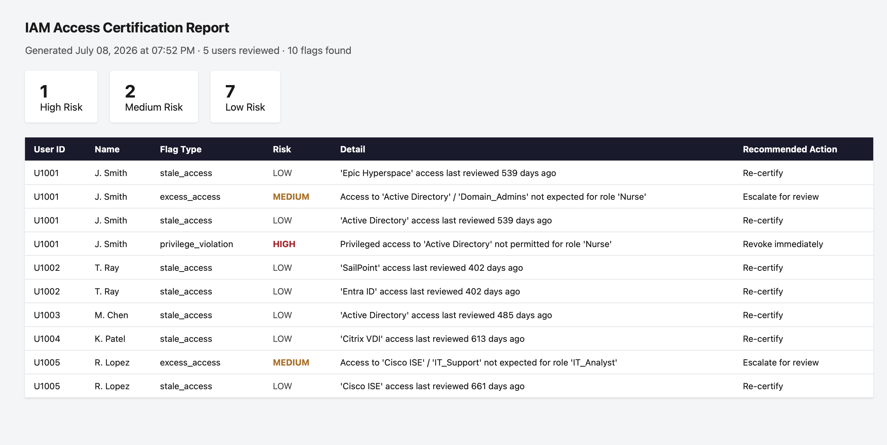

# IAM Access Review Bot

Access certification tool that compares actual user access to defined role baselines, flags excess, stale and privileged access, and produces a risk scored HTML report for reviewers.

> Personal lab project using sample data. It is inspired by entitlement review campaigns in identity governance tools and is not connected to any of them.

## The problem

Manual access reviews are slow and inconsistent at scale. Reviewers need a repeatable answer to one question: does this person still have the access their role calls for?

## What it does

Given a **role baseline** (what each role should have) and an **access export** (what users actually have), the tool flags three kinds of issues:

| Flag | Meaning |
| --- | --- |
| Excess access | A system or group not expected for the role |
| Stale access | An entitlement not reviewed in more than 90 days |
| Privilege violation | Privileged access granted to a role that should not have it |

Each flag gets a risk level (low, medium or high) and a recommended action: re-certify, escalate or revoke immediately. Results are compiled into an HTML report.

## Example output



## Quick start

```bash
git clone https://github.com/markthedev12/iam-access-review-bot.git
cd iam-access-review-bot
python3 -m venv venv
source venv/bin/activate
pip install -r requirements.txt
python3 main.py
```

The report is saved as `access_review_report.html` in the project root.

## Project structure

```
data/                  Sample role baseline and access export
src/
  models.py            Data classes (User, Entitlement, Flag)
  loader.py            CSV and JSON ingestion
  review_engine.py     Flagging logic
  report_generator.py  HTML report rendering
templates/             Jinja2 report template
tests/                 Unit tests
main.py                Entry point
```

## Tech stack

Python, pandas for data handling, Jinja2 for report templating.

## Limitations

* Runs on sample data only. It does not pull from a live identity system.
* The stale threshold and risk rules are fixed defaults.
* It supports the three flag types above and nothing else.

## What I would do next

- [ ] Make the stale threshold and risk rules configurable
- [ ] Run the tests in GitHub Actions and add a badge
- [ ] Export findings as CSV and JSON as well as HTML
- [ ] Pull real access data from AWS IAM with boto3

## Why I built this

Access governance is where a lot of real breach risk sits: people keeping access they should no longer have. I work with identity and access issues day to day, and I wanted to build the logic of an access review end to end instead of only using tools that do it.

## Author

Mark Schwinn · [Website](https://markschwinn.com) · [LinkedIn](https://www.linkedin.com/in/mark-schwinn-994625362/)
